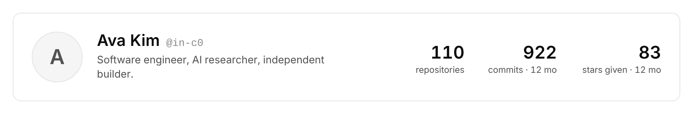
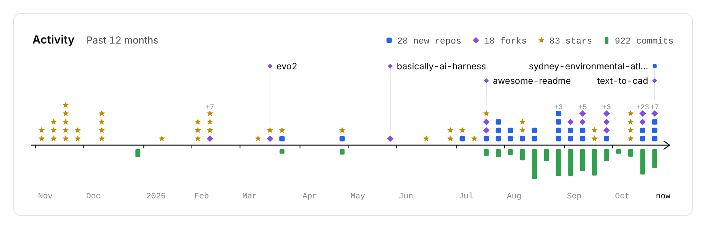
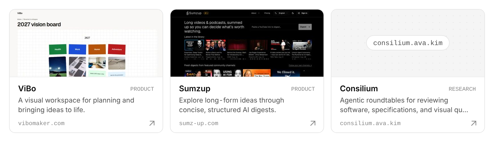
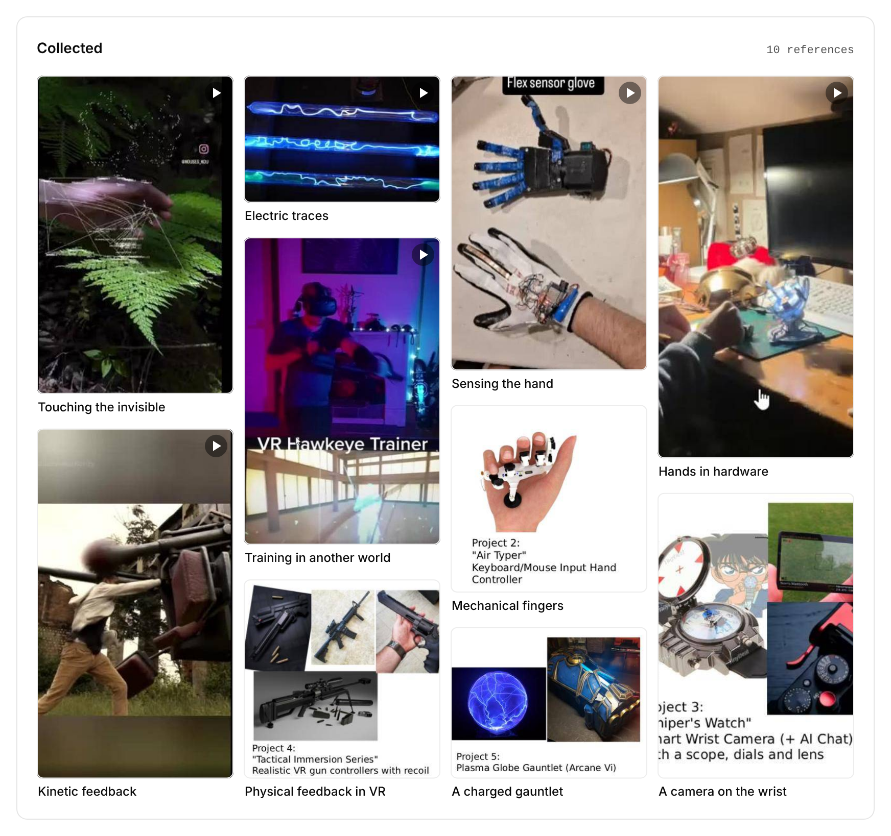

# Prettier Profile

GitHub profile cards that look like they belong to a component library. A daily GitHub Action renders them to SVG, so they work in any `README.md`.

**[Docs](https://profile.ava.kim)** · **[Try it with your @](https://profile.ava.kim/#intro)** · [Configuration](https://profile.ava.kim/#config)

<a href="https://profile.ava.kim/#activity"><picture><source media="(prefers-color-scheme: dark)" srcset="https://raw.githubusercontent.com/in-c0/my-prettier-github-profile-readme/output/activity-dark.svg"></picture></a>

<details><summary>3 months</summary>

<a href="https://profile.ava.kim/#activity"><picture><source media="(prefers-color-scheme: dark)" srcset="https://raw.githubusercontent.com/in-c0/my-prettier-github-profile-readme/output/activity-3m-dark.svg"></picture></a>

</details>
<details><summary>All time</summary>

<a href="https://profile.ava.kim/#activity"><picture><source media="(prefers-color-scheme: dark)" srcset="https://raw.githubusercontent.com/in-c0/my-prettier-github-profile-readme/output/activity-all-dark.svg"></picture></a>

</details>

<a href="https://profile.ava.kim/#coding-type"><picture><source media="(prefers-color-scheme: dark)" srcset="https://raw.githubusercontent.com/in-c0/my-prettier-github-profile-readme/output/coding-type-dark.svg"></picture></a>

<a href="https://profile.ava.kim/#curiosity"><picture><source media="(prefers-color-scheme: dark)" srcset="https://raw.githubusercontent.com/in-c0/my-prettier-github-profile-readme/output/curiosity-dark.svg"></picture></a>

<a href="https://profile.ava.kim/#collected"><picture><source media="(prefers-color-scheme: dark)" srcset="https://raw.githubusercontent.com/in-c0/my-prettier-github-profile-readme/output/collected-dark.svg"></picture></a>

<a href="https://profile.ava.kim/#header"><picture><source media="(prefers-color-scheme: dark)" srcset="https://raw.githubusercontent.com/in-c0/my-prettier-github-profile-readme/output/header-dark.svg"></picture></a>

<p>
<a href="https://ui.ava.kim/knurl/"><picture><source media="(prefers-color-scheme: dark)" srcset="https://raw.githubusercontent.com/in-c0/my-prettier-github-profile-readme/output/project-knurl-dark.svg"></picture></a>
<a href="https://vibomaker.com"><picture><source media="(prefers-color-scheme: dark)" srcset="https://raw.githubusercontent.com/in-c0/my-prettier-github-profile-readme/output/project-vibo-dark.svg"></picture></a>
<a href="https://sumz-up.com"><picture><source media="(prefers-color-scheme: dark)" srcset="https://raw.githubusercontent.com/in-c0/my-prettier-github-profile-readme/output/project-sumzup-dark.svg"></picture></a>
</p>

## Components

| Component | |
| --- | --- |
| **Profile header**<br>Avatar, name, one line, three counters |  |
| **Activity arrow**<br>◼ new repo · ◆ fork · ★ star above the line, commits below. `30d` · `3m` · `12m` · `all` |  |
| **Coding type**<br>An archetype like *Daylight Sprinter* from commit hours, rhythm and breadth, with the numbers behind it |  |
| **Curiosity**<br>What you star, grouped into interests month by month; the last 90 days highlighted |  |
| **Project card**<br>Screenshot or dotted cover, two lines, domain |  |
| **Collected**<br>Masonry gallery of references, video stills marked |  |

Every card follows GitHub's light or dark theme.

## Quick start

1. Copy [`.github/workflows/cards.yml`](.github/workflows/cards.yml) into any repo you own, or use the action directly:

   ```yaml
   - uses: in-c0/my-prettier-github-profile-readme@main
     with:
       config: profile.config.json
   ```

2. Add a [`profile.config.json`](profile.config.json):

   ```json
   {
     "username": "your-username",
     "activity": { "range": "12m" },
     "projects": [{ "id": "app", "title": "My App", "summary": "One line.", "url": "https://my.app" }]
   }
   ```

3. Paste `dist/README-snippet.md` from the `output` branch into your profile README.

Private activity is optional: set `"activity": { "private": true }` and add a personal access token as the `PROFILE_TOKEN` secret. Private repos show up as counts only, never names.

## Develop

```sh
npm test               # renderer tests
npm run build:sample   # render dist/ from sample data, no network
npm run dev            # docs at http://localhost:8080
```

MIT
